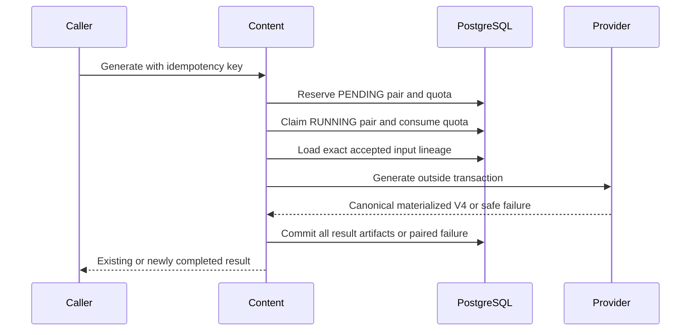

# Ticket 06 grounding

This is a derived explanation of the current Content backend for the Go port. The approved phase specification and Ticket 06 define migration scope. Source references below identify the behavior the port must preserve.

## Overview

Content turns an accepted Idea and an exact Content DNA version into an editable script. Generation creates one Content record, one mutable Draft, and an immutable initial Version. A creator can save the Draft and explicitly accept snapshots as further immutable Versions. Teleprompter and Edit Guide use the accepted Version, so unsaved or unaccepted edits do not change the production script. The application services own these workflows in `src/modules/content/application`.

The current Go integration pattern is `ideas.Service` in `backend/internal/ideas/generation.go:82`. A service receives `workspace.MembershipSubject`, checks current access, owns short SQL transactions, and invokes its provider outside a transaction. `backend/internal/httpapi/server.go:19` converts generated transport values into domain inputs and maps safe errors. Ticket 06 adds the Content capabilities to `backend/internal/content`, which currently contains `queue.go`. Drizzle remains the schema and migration owner.

## Key concepts

- A generation Attempt and its AI Run form one lifecycle pair. A separate quota reservation distinguishes reserved work from an invocation that already consumed quota. `content-generation-repository.ts:65` defines the pair.
- A Content record stores immutable workspace, source-Idea, generation-Attempt, content-language, and format identity. Its mutable `acceptedVersionId` points to a Version of that same Content. `src/db/schema/content-generation.ts:147` defines Content.
- `ContentDocument` is the strict persisted V1 through V4 union. V1 stores plain text. V2 adds paragraph blocks and directions. V3 adds managed Asset IDs. V4 adds B-roll search text. `content-script-contracts.ts:563` defines the union.
- The Draft stores the current document and a positive revision. Saves compare the submitted revision before writing. Versions snapshot complete documents and cannot be updated. `content-generation.ts:179` and `content-generation.ts:196` define their storage.
- Asset references are a derived projection of document `assetId` values. A document write validates the Assets and updates this projection in the same transaction. `asset-reference-repository.ts:47` owns that persistence check.

Paths named without a directory in the workflow sections are under `src/modules/content/application`. Document functions are under `src/modules/content/domain/content-script-contracts.ts`.

## How it works

### Generation reserves and claims one invocation

`acceptContentGeneration` in `content-generation-service.ts:303` authenticates the caller and parses a strict generation request. It normalizes optional instructions and calculates a SHA-256 fingerprint. The fingerprint includes generation kind, source Idea, base DNA version, requested language, format, and instructions. It excludes the workspace and idempotency key. Serialized string lengths use JavaScript UTF-16 units. `serializeContentScriptGenerationRequest` in `content-script-contracts.ts:1378` defines that exact serialization.

`reserveContentGenerationOperation` in `content-generation-repository.ts:412` locks the workspace and checks ownership before looking up the workspace-scoped idempotency key. A matching fingerprint replays the existing pair before rechecking mutable Idea or DNA eligibility. A different fingerprint returns a conflict. A new operation requires an owned `ACCEPTED` Idea and the current AI-ready DNA version matching the submitted base version. The requested content language must be configured in that DNA.

Reservation recovers stale pending work, then checks the Content quotas. The limits are two live or invoked reservations per ten minutes and eight per twenty-four hours. A quota rejection creates no Attempt, AI Run, or reservation. An accepted reservation creates all three as one transaction. The stale threshold is 105 seconds. The constants and recovery functions are in `content-generation-repository.ts:49`, `:901`, and `:918`.

`generateContentScript` in `content-generation-service.ts:597` can execute an existing `PENDING` reservation. `startContentGenerationInvocation` in `content-generation-repository.ts:530` locks the lifecycle pair and reservation, changes the pair to `RUNNING`, and records `invokedAt` atomically. Only the caller that performs that transition invokes the provider. A running or terminal pair resolves its existing state without another call.

After claiming invocation, the service loads the Idea and DNA version recorded in the Attempt. It does not recheck the current DNA pointer or require the Idea still to be accepted. Provider construction occurs after the `RUNNING` transition. A provider-factory failure therefore retains consumed invocation quota. `loadAcceptedContentGenerationInputs` in `content-generation-repository.ts:232` and `generateContentScript` at service line 660 show that order.

The provider boundary returns canonical V4. The generated wire shape has schema version 1 and no persistent block, direction, or Asset IDs. `parseGeneratedContentDocumentV4` in `content-script-contracts.ts:1231` normalizes generated text, rejects B-roll queries containing URLs or provider identifiers, assigns local UUIDs once, and canonicalizes the result. The AvalAI adapter and provider contract live in `src/modules/ai/infrastructure/avalai/avalai-generate-content-script-provider.ts` and `src/modules/ai/domain/generate-content-script.ts`.

`completeContentGenerationInvocation` in `content-generation-repository.ts:617` writes one successful result transaction. It creates Content, Draft revision 1, `AI_GENERATED` Version 1, and the exact same canonical V4 value as the AI Run snapshot. It also writes safe usage and correlation data, completes both lifecycle rows, clears the source Idea's queue position, and normalizes the remaining queue. The initial result has no accepted pointer.

`failContentGenerationPairInTransaction` at repository line 804 moves active pairs to one safe failure category. Pending failure releases uninvoked quota. Running failure retains consumed quota. Recovery cannot rewrite a terminal pair, and a late provider result cannot replace recovered failure. Retry creates a new operation with current DNA while retaining the original Idea, language, format, and instructions. `retryContentGenerationAttempt` in `content-generation-service.ts:424` owns that path.

### Draft saves preserve revision order and history

`saveContentDraft` in `content-draft-service.ts:154` authenticates, parses the request, checks workspace ownership, and validates the submitted document. Its transaction rechecks ownership and locks both Content and Draft. The revision comparison precedes migration and equality checks. `lockContentDraftWriteTarget` in `content-draft-repository.ts:62` provides the lock, and `updateContentDraftIfRevisionMatches` at line 29 applies a second SQL revision guard.

An unchanged V1 submission can return the current Draft. The first changed V1 save creates one `LEGACY_DRAFT_CHECKPOINT` containing the stored V1 document, then persists the submitted document projected to V4. A stored V2 Draft accepts a structured submission and upgrades it to V4. A stored V3 or V4 Draft requires a V4 submission. Current V3 and V4 saves increment the revision even when canonical documents compare equal. The branches are in `content-draft-service.ts:194`.

Before the update, `validateReferencedAssets` in `asset-reference-repository.ts:47` locks referenced Asset rows in sorted ID order and checks workspace, `READY` status, and cue compatibility. B-roll permits IMAGE or VIDEO. Sound permits AUDIO. The Draft update and replacement of Draft reference rows share the transaction. This prevents attach and delete races while preserving immutable Versions, AI snapshots, and the accepted pointer.

### Acceptance snapshots the authoritative Draft

`acceptContent` in `content-acceptance-service.ts:174` checks ownership and locks Content and Draft together. Expected revision validation occurs before accepted-Version lookup or equality. The Content row serializes Version-number allocation as well as acceptance and Draft saves. `lockContentForAcceptance` in `content-acceptance-repository.ts:20` and `nextContentVersionNumber` at line 57 own those operations.

An existing accepted pointer must resolve to a same-Content `CREATOR_ACCEPTED` Version. Structured acceptance compares the authoritative Draft against the currently accepted document. Equality returns that accepted Version. Otherwise acceptance appends the next Version, validates and writes its Asset references, and updates the pointer atomically. Reverting to an older historical document still creates a new Version when it differs from the currently accepted one. `content-acceptance-service.ts:199` and `:315` contain these decisions.

V1 acceptance is an explicit migration. One transaction checkpoints the exact legacy document, projects V4, increments the Draft revision, creates a separate accepted Version, writes Draft and Version references, and updates the pointer. Projection or Asset failure rolls back every part. The legacy branch begins at `content-acceptance-service.ts:227`.

### Reads project documents without rewriting them

`createContentReadApplicationService` in `content-read-service.ts:517` requires workspace membership for reads. Repository joins scope Content, source Idea, generation lineage, and Version records to the workspace. Library order uses Draft update time, then descending Content ID. History uses descending Version number, then creation time.

Detail returns the persisted Draft document, its deterministic V4 editor projection, a V2 compatibility view, revision metadata, accepted state, and Version history. `toDraftDto` at service line 348 and `toContentDetail` at line 410 build these values. `projectContentDocumentToV4` in `content-script-contracts.ts:858` upgrades documents in memory. For V1, it splits on LF, removes whitespace-only lines, preserves meaningful line whitespace, and derives UUIDs from SHA-256 of the index and text. Read projections do not persist those upgrades.

Teleprompter and Edit Guide load the Version named by the accepted pointer. Their repository queries omit the Draft. No pointer returns `NO_ACCEPTED_VERSION`. Missing, malformed, nonaccepted-source, or invalid-number Versions return `UNAVAILABLE` with no public accepted ID. `content-read-repository.ts:211` and `:238`, together with `content-read-service.ts:685` and `:771`, define this path.

For V1, both views preserve one exact legacy text block. Teleprompter projects performance hints and omits edit directions. Edit Guide preserves edit-direction order and payloads, including V4 search text. The projection functions are in `content-script-contracts.ts:584` and `:674`. Content language comes from immutable Content metadata. These operations receive no UI locale, so interface-language changes cannot transform creator text.

## Where things live

- `src/modules/content/domain/content-script-contracts.ts` owns document validation, canonicalization, equality, legacy projections, generation fingerprinting, and production-view projections.
- `src/modules/content/application/content-generation-service.ts` and `content-generation-repository.ts` own generation lifecycle, reservations, provider execution, retry, recovery, and result persistence.
- `content-draft-service.ts`, `content-draft-repository.ts`, `content-acceptance-service.ts`, and `content-acceptance-repository.ts` own Draft writes and accepted Versions.
- `content-read-service.ts` and `content-read-repository.ts` own library, detail, history, Attempt results, Teleprompter, and Edit Guide reads.
- `asset-reference-repository.ts` owns attachment validation and derived reference writes.
- `src/db/schema/content-generation.ts` and the committed Drizzle migrations own persistence constraints. `drizzle/0009_smart_ladybug.sql:1` checks matched lifecycle outcomes, required successful artifacts, and equality between Version 1 and the AI Run snapshot.

## Gotchas

- Copying the current Go Ideas replay branch would strand an accepted pending Content Attempt. Content reservation and invocation are separate capabilities, and a pending replay must remain executable.
- Copying Go Ideas provider-construction order would change quota behavior. Content marks invocation before loading inputs or constructing its provider.
- Generated document materialization must happen once. Draft, Version 1, and the AI snapshot must share UUIDs and canonical JSON.
- `projectContentDocumentToV3` is an alias of the V4 projection at `content-script-contracts.ts:868`. Older assertions still expect V3 in `content-acceptance-service.integration.test.ts:348` and `content-read-service.integration.test.ts:415`. The approved ticket and live document path require V4 while preserving legacy reads. This is a test expectation discrepancy, with no authoritative scope conflict found.
- Most string limits use UTF-16 units. B-roll search queries use Unicode code points. Go byte length or rune length cannot replace all existing length checks.
- `parseSubmittedDraft` at `content-draft-service.ts:81` validates the raw union before canonicalization. A query with leading or trailing whitespace can fail this boundary even though direct V4 canonicalization trims it.
- `contentDocumentsEqual` at `content-script-contracts.ts:1025` bridges V2 with V3 and V3 with V4. Direct V2 with V4 comparison returns false. Equality is structural and ignores object-property insertion order.
- The database enforces same-Content accepted-pointer identity. The application separately enforces `CREATOR_ACCEPTED`. Version immutability is enforced by `drizzle/0006_salty_xavin.sql:226`; `drizzle/0008_puzzling_sage.sql:16` permits only the accepted-pointer Content update.
- A V1 projection can exceed structured block limits. Failure must preserve the legacy Draft and every historical record.

The parent recorded a passing `npm run backend:test` baseline before Ticket 06 changes on 2026-10-25. This explanation was checked against source and migration text. This read-only explanation pass did not run tests or change production code.
